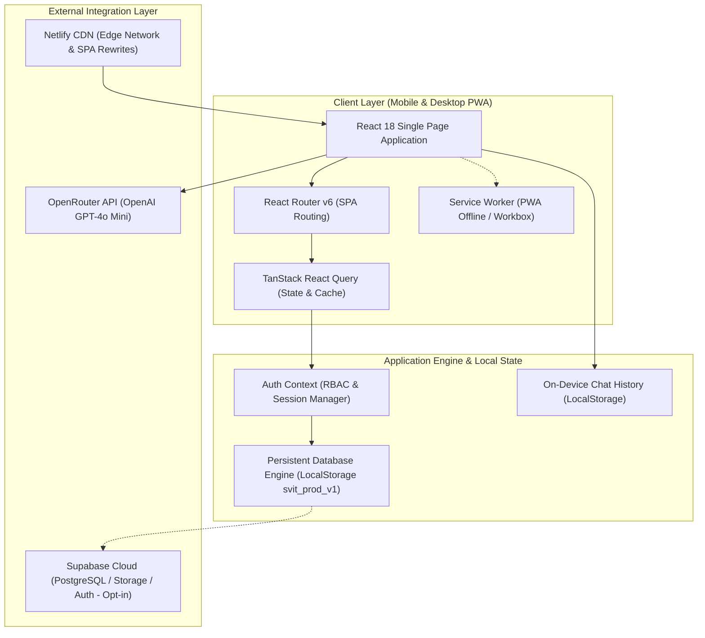
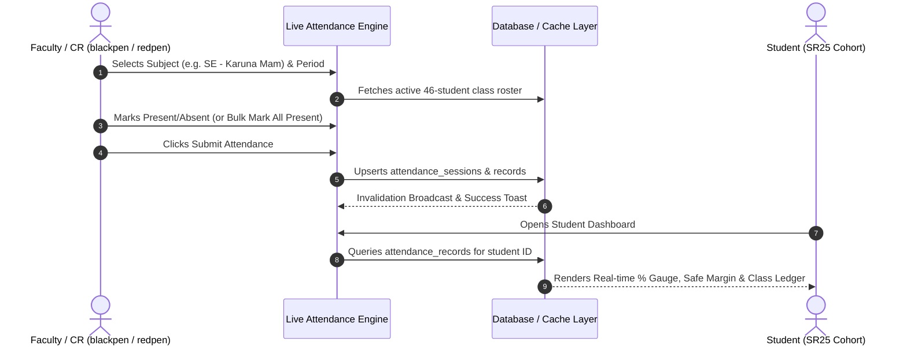

# SVIT Academic Portal — Progressive Web App (PWA)

[](https://vitejs.dev/)
[](https://react.dev/)
[](https://tailwindcss.com/)
[](https://openrouter.ai/)
[](https://www.netlify.com/)
[]()
[-blueviolet?style=flat)]()

An academic management platform engineered exclusively for **Swamy Vivekananda Institute of Technology (SVIT)**. The platform is piloted for the **CSE – Cyber Security** department under the **SR25 regulation**, serving 46 enrolled students, the Class Representative (CR), and department Faculty.

SVIT Portal replaces fragmented paper rosters, manual attendance registers, and messaging broadcasts with an installable, mobile-responsive Progressive Web App (PWA) with live aggregate attendance, a master weekly timetable matrix, an AI academic tutor (**Blu**), and administrative configuration.

---

## 🏛️ Academic & Pilot Cohort Context

| Dimension | Details |
| :--- | :--- |
| **Institution** | Swamy Vivekananda Institute of Technology (SVIT), Secunderabad |
| **Department** | Computer Science & Engineering (Cyber Security) |
| **Academic Regulation** | **SR25** |
| **Active Cohort Size** | **46 Students** (40 Regular + 6 Lateral Entry LE1–LE6) |
| **Hall Ticket Prefixes** | Regular: `25P71A6201` – `25P71A6243` • Lateral Entry: `26P75A6201` – `26P75A6206` |
| **Lead Subject & Faculty** | **Software Engineering (SE / SE-LAB)** — **Karuna Mam** |
| **Supporting Faculty** | Dr. K. Srinivas (CNS) • Prof. R. Venkatesh (CFIR) • Mr. Suresh Babu (CN) • Mrs. Anitha Reddy (DBMS) |

---

## 🏗️ System Architecture



---

## 🔄 User & Navigation Flow

```mermaid
flowchart TD
    Start([User Visits Portal]) --> Decision{Select Login Mode}
    
    Decision -->|Student| StudentLogin[Student Portal Login]
    Decision -->|Guest Observer| GuestLogin[Guest Access (Observer)]
    Decision -->|Staff| StaffLogin[Faculty / CR Login]

    StudentLogin -->|Enter Hall Ticket only| StudentHome[Student Dashboard]
    GuestLogin -->|1-Click Access| StudentHome
    StaffLogin -->|Username + Secure Password| StaffHome[Admin Operations Hub]

    subgraph "Student Experience"
        StudentHome --> AttGauge[Live Attendance Gauge & Margin Alert]
        StudentHome --> CohortLedger[Class Attendance Ledger (46 Students)]
        StudentHome --> Timetable[Master Weekly Timetable Matrix]
        StudentHome --> BluAI[Blu Academic Tutor (Live Streaming)]
        StudentHome --> Portals[Assignments, Study Notes & Marks]
    end

    subgraph "Staff Experience (CR / Faculty)"
        StaffHome --> LiveAtt[Live Attendance Engine (1-Tap Bulk Mark)]
        StaffHome --> Broadcasts[Broadcast Announcement Manager]
        StaffHome --> Resources[Upload Notes & Assignments]
        StaffHome --> Verification[Notebook & Assignment Submission Ledger]
        StaffHome --> ResultsPub[Publish Mid-Term & Internal Marks]
        StaffHome --> Settings[Master Settings: Edit/Remove All Data]
    end
```

---

## 📊 Live Attendance Lifecycle



---

## 🤖 AI Academic Tutor ("Blu") Architecture

```mermaid
flowchart LR
    StudentPrompt["Student Query (e.g., Explain Agile in SE)"] --> ContextInject["Context Injector (SVIT Cyber Security + Karuna Mam Syllabus)"]
    ContextInject --> APICall["OpenRouter API (model: openai/gpt-4o-mini, max_tokens: 800)"]
    APICall --> StreamSSE["Server-Sent Events (SSE) Stream"]
    StreamSSE --> CleanFilter["CleanAiMessage Filter (Removes #, *, and Clutter)"]
    CleanFilter --> RenderUI["Clean Formatted Message (Bold Headings & Monospace Code)"]
    RenderUI --> OnDeviceSave["Saved Locally on Device (Never sent to Database)"]
```



---

## 🔐 Credentials & Access Control Directory

### 1. Student Access (SR25 Regulation)
- **Authentication**: **No password required**. Students enter their official SVIT Hall Ticket.
- **Accepted Range**: `25P71A6201` – `25P71A6243` (Regular) or `26P75A6201` – `26P75A6206` (LE).
- **Access Scope**: Read-only access to personal attendance, class ledger, timetable, study notes, submissions, results, and Blu AI Tutor.

### 2. Guest Observer Access
- **Authentication**: One-click **"Login as Guest (Observer Account)"** button on the student login screen.
- **Access Scope**: Demo observer profile allowing evaluation of student workflows without modifying records.

### 3. Administrative Credentials (CR & Faculty)
- **Role 1 (Class Representative)**:
  - **Username**: `blackpen`
  - **Password**: `#cr@svit`
- **Role 2 (Department Faculty)**:
  - **Username**: `redpen`
  - **Password**: `#fac@svit`
- **Administrative Security Master Code**:
  - **Security Code**: `Alpha@A6`
  - Required in **Master Settings → Staff Passwords** to authorize password changes for `blackpen` or `redpen`.

---

## 🚀 Key Functional Modules

### 1. Real-Time Student Attendance Dashboard
- **Aggregate Gauge**: Dynamic circular SVG indicator tracking attended vs. conducted classes.
- **Eligibility Thresholds**:
  - **Green ($\ge 75\%$)**: Good standing. Displays how many classes the student can safely miss.
  - **Amber / Red ($< 75\%$)**: Shortage alert. Calculates the exact number of consecutive classes required to reach 75%.
- **Subject-Wise Mini Cards**: Breakdown for all 7 enrolled subjects (SE, CNS, CFIR, CN, DBMS, Labs).

### 2. Cohort Attendance Ledger (Everyone's Attendance)
- **Class-Wide Roster**: Complete table of all 46 students displaying Roll Number, Hall Ticket, Name, Attended/Total, and Attendance %.
- **Self-Highlighting**: Logged-in student's row is highlighted in electric blue with a **YOU** badge.
- **Search & Filters**: Real-time filtering by Student Name, Roll No, or Hall Ticket; filter pills for **All (46)**, **Eligible ($\ge 75\%$)**, and **Shortage ($< 75\%$)**.

### 3. Master Timetable Hub
- **Weekly Matrix Grid**: College schedule grid (Monday–Saturday) showing Period 1 through Period 5, Tea Break, and Lunch Break.
- **Active Day Highlight**: Visual indicator for today's active schedule.
- **Examination Timetable**: Mid-Term and Final examination schedules with hall allocations.

### 4. AI Academic Tutor — "Blu"
- **Model**: OpenAI GPT-4o Mini streamed via OpenRouter API.
- **Domain Context**: Embedded knowledge of SVIT CSE Cyber Security, including **Karuna Mam's Software Engineering** curriculum (IEEE SRS, Agile vs Waterfall, UML diagrams).
- **Clean Formatting**: Strip formatting clutter (raw hashtags `#` and asterisks `*`) while presenting clean bold titles, bullet points, and code syntax blocks.
- **Privacy**: Chat history is persisted exclusively on the student's device (`localStorage`) and never written to an external database.

### 5. Master Academic Settings (Admin)
- **Full CRUD Controls**: Administrators can **Add**, **Edit**, and **Delete**:
  - Course Subjects & Assigned Faculty
  - Timetable Period Slots
  - Student Enrolled Roster
  - Scheduled Examinations
- **Staff Password Manager**: Reset and change credentials for `blackpen` and `redpen` with authorization code `Alpha@A6`.

---

## 🌐 Netlify Deployment Guide

The portal is pre-configured for automated continuous deployment on Netlify.

### 1. Configuration Files
- **[`netlify.toml`](./netlify.toml)**: Defines build command, publish directory (`dist`), and single-page application redirect rules.
- **[`public/_redirects`](./public/_redirects)**: Serves `/* /index.html 200` to prevent 404s on browser reloads.

### 2. Deployment Steps
1. Push this repository to GitHub, GitLab, or Bitbucket.
2. Sign in to [Netlify](https://app.netlify.com/) and click **"Add new site" → "Import an existing project"**.
3. Select your repository.
4. Verify the build configuration:
   - **Build command**: `npm run build`
   - **Publish directory**: `dist`
5. Under **Environment variables**, configure:
   - `VITE_OPENROUTER_API_KEY`: Your OpenRouter API key for the Blu AI tutor.
   - `VITE_SUPABASE_URL`: (Optional) Your live Supabase URL if connecting to remote Postgres.
   - `VITE_SUPABASE_ANON_KEY`: (Optional) Your live Supabase Anon Key.
6. Click **"Deploy site"**. Netlify will build the production bundle and generate the PWA service worker automatically.

---

## 💻 Local Development Setup

### Prerequisites
- Node.js version 18 or higher (Node 20+ recommended).
- npm (bundled with Node).

### Installation & Run
```bash
# 1. Clone repository
git clone https://github.com/your-repo/svit-portal.git
cd svit-portal

# 2. Install dependencies
npm install

# 3. Configure environment variables
# Copy or create .env file:
# VITE_OPENROUTER_API_KEY=sk-or-v1-your-key-here

# 4. Start local development server with host binding
npm run dev -- --host
```

Access the local instance in your browser at `http://localhost:5173/`.

### Production Build Verification
```bash
# Build production bundle and service worker
npm run build

# Preview production build locally
npm run preview
```

---

## 📁 Repository Directory Structure

```text
svit-portal/
├── public/
│   ├── _redirects              # Netlify SPA client-side route rewrite
│   ├── favicon.svg             # Application logo
│   └── pwa-192x192.png         # PWA home screen icon
├── src/
│   ├── components/
│   │   ├── chat/               # CleanAiMessage parser component
│   │   ├── layout/             # AppHeader & Navigation components
│   │   ├── routing/            # ProtectedRoutes & role gate guards
│   │   └── ui/                 # Reusable UI library (Badge, Button, Modal, Toaster)
│   ├── contexts/
│   │   └── AuthContext.jsx     # Role-Based Authentication & password manager
│   ├── layouts/
│   │   ├── AdminLayout.jsx     # Responsive Desktop sidebar + Mobile admin bar
│   │   └── StudentLayout.jsx   # Responsive Desktop sidebar + Mobile student bar
│   ├── lib/
│   │   ├── mockDb.js           # Production clean data engine (LocalStorage backed)
│   │   ├── roster.js           # 46 SR25 student roster & staff credentials
│   │   ├── supabase.js         # Unified Supabase / Local mock client router
│   │   └── utils.js            # Formatters, attendance math & date helpers
│   ├── pages/
│   │   ├── admin/              # LiveAttendance, Broadcasts, Settings, Results
│   │   ├── auth/               # StudentLogin & StaffLogin
│   │   └── student/            # Dashboard, AttendanceDetail, Timetable, BluChat
│   ├── App.jsx                 # Route definitions & React Query provider
│   ├── index.css               # Cyber Obsidian design tokens & typography
│   └── main.jsx                # Application mounting entry point
├── .env                        # Local API credentials
├── netlify.toml                # Netlify deployment configuration
├── tailwind.config.js          # Custom color palette & breakpoints
├── vite.config.js              # Vite bundler & PWA Workbox plugin config
└── README.md                   # System documentation & technical specifications
```

---

## 📜 Academic Integrity & License
Designed exclusively for academic evaluation and internal institutional management at **Swamy Vivekananda Institute of Technology (SVIT)**. All rights reserved.
